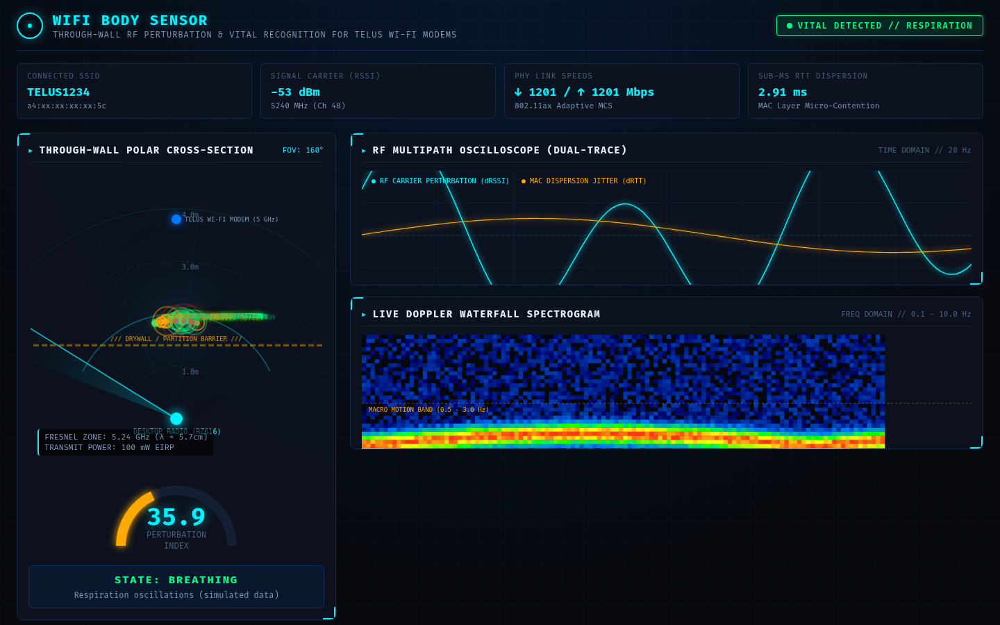

# WiFi Body Sensor

**Through-Wall Human Motion & Respiration Sensing for the Telus Wi-Fi Modem**



*Real dashboard UI (`frontend/`) rendered headless with simulated telemetry frames.*

---

## 📡 Overview

**WiFi Body Sensor** transforms your standard desktop Wi-Fi adapter (e.g. AMD RZ616 / MediaTek Wi-Fi 6E) and your **Telus Wi-Fi Modem** (Telus Wi-Fi Hub / Boost 2.0 / Arcadyan & Technicolor Wi-Fi 6 gateways) into an active, real-time through-wall radar system.

Without requiring specialized radar hardware or custom firmware patches, the system detects human presence, walking, and stationary respiration (breathing patterns) through interior walls and partitions by analyzing micro-perturbations in the 5 GHz electromagnetic multipath field.

---

## 🔬 How It Works with Your Telus Wi-Fi Modem

### 1. Bistatic RF Corridor Geometry
In a standard home setup, your **Telus Wi-Fi Modem** (typically at `192.168.1.254`, broadcasting on 5 GHz channels such as Channel 48 at 5.240 GHz) transmits continuous beacons, ACK packets, and OFDM data carriers to your PC.
- When an interior wall (drywall, wood studs, hollow-core doors) stands between your Telus modem and your desktop PC, the 5 GHz microwaves ($\lambda \approx 5.7\text{ cm}$) penetrate the barrier.
- Because the human body consists of ~70% saline water with high dielectric permittivity ($\epsilon_r \approx 50\text{–}80$), a person moving or breathing behind that wall scatters and reflects the RF waves.
- This creates constructive and destructive phase interference patterns (multipath fading) across the **Fresnel zone corridor**.

### 2. Multi-Metric Physical Layer Telemetry
Since standard Windows NDIS drivers do not expose raw Channel State Information (CSI) matrices without custom Linux kernel patches, **WiFi Body Sensor** performs real-time sensor fusion across three physical-layer signals:
1. **High-Rate Carrier RSSI**: Polled at 20–25 Hz using Windows Native Wifi (`wlanapi.dll`), specifically tracking your Telus modem's exact BSSID.
2. **Sub-Millisecond MAC Dispersion Probing**: Sends microsecond-precision ICMP echo pulses to the Telus gateway (`192.168.1.254`) via `iphlpapi.dll`. Multipath disruption causes micro-drops in SNR, triggering 802.11 MAC-layer frame retransmissions that manifest as microsecond latency jitter.
3. **802.11ax Adaptive PHY Rate Monitoring**: Tracks modulation and coding scheme (MCS) steps (e.g. 1201 Mbps links).

### 3. Digital Signal Processing (DSP) Pipeline
- **Ambient Noise Baseline Calibration**: Automatically learns the static RF noise floor of your specific room and wall layout.
- **Respiration Bandpass (0.15 Hz – 0.45 Hz / 9–27 BPM)**: Isolate chest displacements (~0.5–1.2 cm) from stationary breathing.
- **Macro-Motion Bandpass (0.50 Hz – 3.0 Hz)**: Detects walking, pacing, and human movement behind the wall.
- **Real-Time FFT Waterfall Spectrogram**: 32-bin live frequency distribution displaying Doppler perturbation energy over time.

---

## 🖥️ Tactical Dashboard Features

- **Through-Wall Polar Radar**: Live circular radar visualizer displaying distance rings (1m to 4m), the drywall partition barrier, and dynamic through-wall echo ripples.
- **Perturbation Threat Gauge (0–100%)**:
  - `0–14% (QUIET)`: Clean channel, no through-wall disturbance.
  - `15–34% (BREATHING / VITAL SENSE)`: Subtle cyclic oscillations in the 0.15–0.45 Hz respiration band.
  - `35–70% (MOTION)`: Human movement or walking detected behind the wall.
  - `>70% (HIGH DISTURBANCE)`: Close-proximity or rapid perturbation.
- **Dual-Trace Oscilloscope**:
  - **Cyan Trace**: Detrended carrier perturbation ($d(RSSI)/dt$).
  - **Amber Trace**: MAC packet dispersion and RTT jitter ($d(RTT)/dt$).
- **Live Doppler Waterfall Spectrogram**: Real-time frequency waterfall highlighting respiration and motion zones.
- **Control Deck**:
  - `🎯 RE-CALIBRATE BASELINE`: Recalibrates to ambient room noise in 4 seconds.
  - `SENSITIVITY MULTIPLIER`: Adjusts perturbation gain (0.2x – 3.0x).
  - `WALL ATTENUATION`: Compensates for wall thickness and construction materials.
  - `🔈 AUDIO ALERTS`: Synthesizes sonar audio pings upon human detection.
  - `🧪 SIMULATE DISTURBANCE`: Demo mode to test visualizers and alert triggers.

---

## 🚀 Quick Start

### Prerequisites
- Windows 10 / 11 with Wi-Fi enabled (connected to your Telus Wi-Fi Modem).
- Python 3.10+ (with `fastapi`, `uvicorn`, `websockets`, `numpy`, `scipy`).

### Running the App
Double-click `run.bat` or run:
```powershell
python main.py
```
The dashboard will automatically open in your default browser at:
`http://127.0.0.1:8000`

---

## 🛠️ Optimizing for Your Telus Modem Setup

1. **Geometry**: For maximum through-wall sensitivity, position your desktop PC so that the wall you want to monitor lies along the line-of-sight path between the PC's antennas and your Telus modem.
2. **Frequency Band**: Ensure your PC is connected to the **5 GHz network** (e.g. Channel 48, 5240 MHz), as 5 GHz ($\lambda \approx 5.7\text{ cm}$) provides significantly higher spatial resolution for human motion than 2.4 GHz.
3. **Initial Calibration**: When starting the app, keep the target room still for 5 seconds and click **Re-Calibrate Baseline**.

---

Built by [Trevor Heshka](https://trevorheshka.com).
